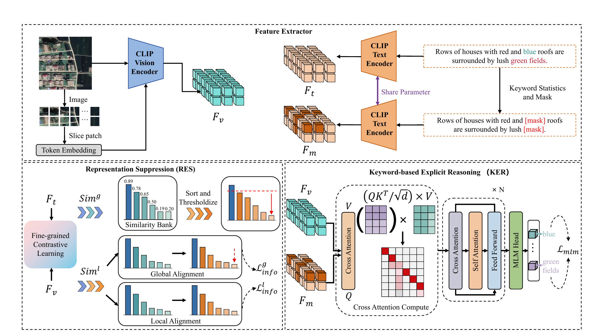
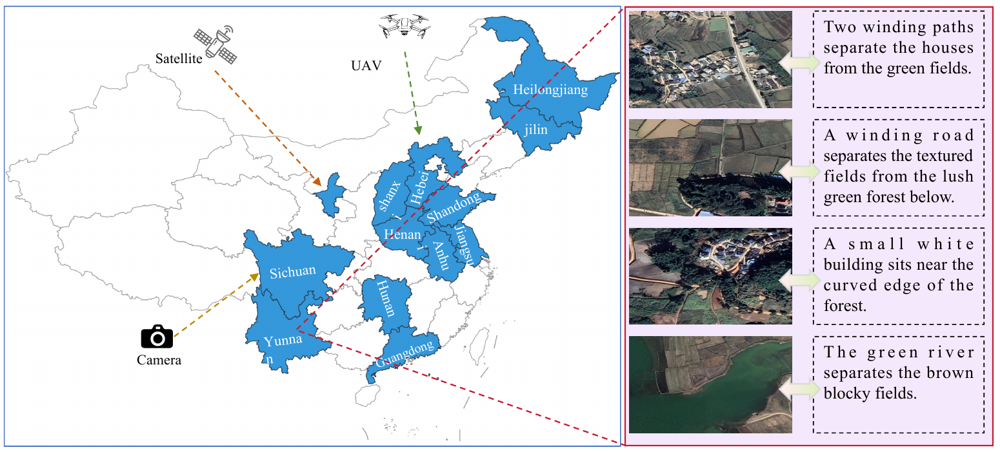
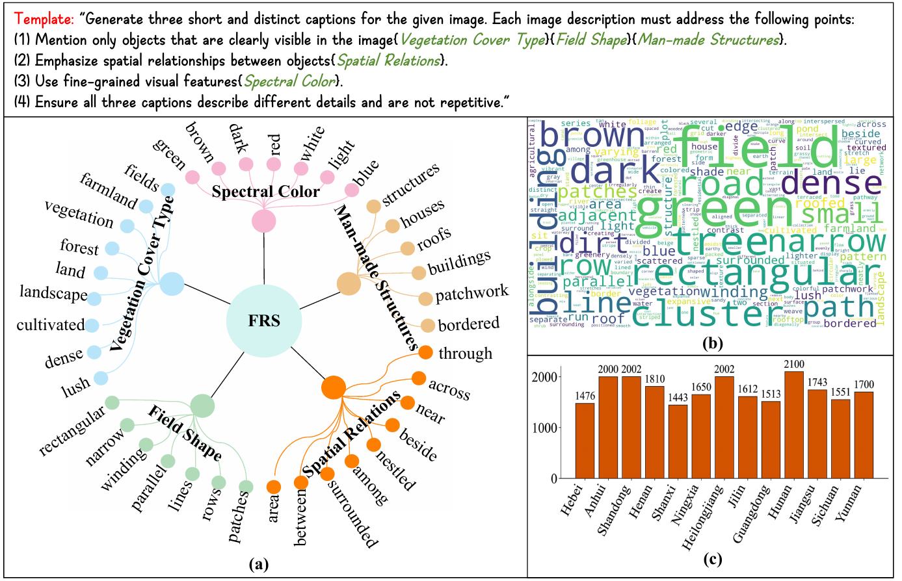

<div align="center">

# E<sup>2</sup>R

### Fine-Grained Image-Text Retrieval for Farmland Remote Sensing

[Method](#method) | [FRS-CMR](#frs-cmr) | [Configuration](#experimental-configuration) | [Code](#code-structure) | [Citation](#citation)

</div>

---


# The complete code and dataset will be released soon.

## Method

<p align="center">
  
</p>

<p align="center"><b>Figure 1.</b> Overview of E<sup>2</sup>R. CLIP encoders produce global and token-level features. RES suppresses low-confidence positive pairs, while KER reconstructs masked farmland keywords through cross-modal reasoning.</p>

E<sup>2</sup>R contains three complementary components:

1. **Global-local alignment** jointly models scene-level semantics and token-level correspondence.
2. **RES** maintains a similarity bank and excludes low-confidence positive anchors after the warm-up stage.
3. **KER** masks frequent farmland terms and predicts them from masked text and visual tokens.


## FRS-CMR

<p align="center">
  
</p>

<p align="center"><b>Figure 2.</b> FRS-CMR image collection. Satellite, UAV, and ground-based imagery covers diverse farmland regions and is paired with concise retrieval-oriented descriptions.</p>

<p align="center">
  
</p>

<p align="center"><b>Figure 3.</b> FRS-CMR annotation protocol and statistics. The structured prompt covers vegetation, field shape, man-made structures, spatial relations, and spectral color.</p>

For each image, [Qwen2.5-VL-7B-Instruct](https://www.modelscope.cn/models/Qwen/Qwen2.5-VL-7B-Instruct) generates three short and non-redundant captions. A randomly sampled 40% of image-caption pairs is independently inspected by four domain experts. The review removes hallucinated content, corrects spatial relations, reduces irrelevant detail, and standardizes terminology. The reported Fleiss' kappa is 0.83-0.89.

| Split | Images | Ratio |
|:--|--:|--:|
| Train | 18,081 | 80% |
| Validation | 2,260 | 10% |
| Test | 2,261 | 10% |
| **Total** | **22,602** | **100%** |

The dataset itself is not distributed in this anonymous repository.

## Experimental configuration

| Category | Setting | Value |
|:--|:--|:--|
| Backbone | Vision / text encoder | OpenCLIP ViT-B/32 |
| Backbone | Input resolution | 224 x 224 |
| Backbone | Context length | 77 tokens |
| Backbone | Embedding dimension | 512 |
| KER | Cross-modal transformer | 2 layers, 8 heads |
| KER | Keyword vocabulary | 256 words |
| RES | Activation epoch | 4 |
| RES | Suppression ratio on FRS-CMR | 1% |
| Optimization | Optimizer | AdamW |
| Optimization | Epochs / batch size | 50 / 128 |
| Optimization | Learning rate | 1.5e-5 |
| Optimization | Weight decay | 0.7 |
| Optimization | Schedule | 200-step warm-up + cosine decay |
| Optimization | Gradient clipping | 50 |
| Hardware | Training devices | 4 x NVIDIA GeForce RTX 3090 |

Both encoders are initialized from the same OpenCLIP ViT-B/32 checkpoint. Weights are not redistributed. Set the local checkpoint and dataset paths in [`configs/frs_cmr.yaml`](configs/frs_cmr.yaml).


Expected CSV format:

```csv
filename,title
example/000001.jpg,"Rectangular green fields lie beside a narrow road."
```

## Citation

```bibtex
@article{anonymous2026e2r,
  title  = {FRS-Searching: Cross-Modal Image-Text Retrieval in Farmland
            Remote Sensing with Large Vision-Language Models},
  author = {Anonymous},
  year   = {2026},
  note   = {Under review}
}
```

<p align="center"><sub>Author names and affiliations are intentionally withheld during anonymous review.</sub></p>
